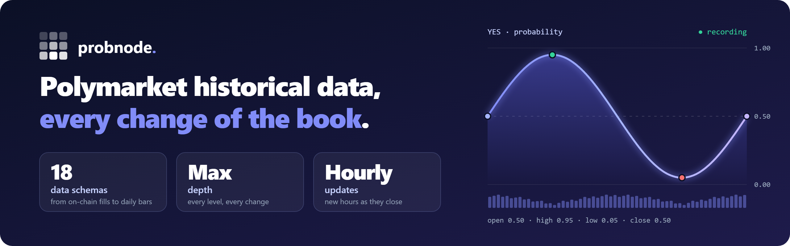
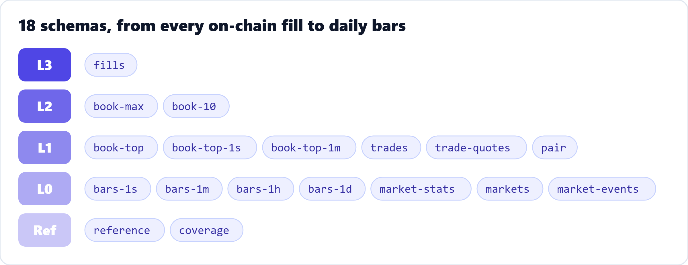

<p align="center">
  <a href="https://probnode.com"></a>
</p>

<p align="center">
  <a href="https://probnode.com/docs"><b>Docs</b></a> ·
  <a href="https://probnode.com/docs/schemas"><b>Schemas</b></a> ·
  <a href="https://probnode.com/catalog"><b>Catalog</b></a> ·
  <a href="https://probnode.com/pricing"><b>Pricing</b></a> ·
  <a href="https://probnode.com/openapi.json"><b>OpenAPI</b></a> ·
  <a href="https://pypi.org/project/probnode-sdk/"><b>PyPI</b></a>
</p>

## About ProbNode

ProbNode records Polymarket at full depth: every change of every price level of every outcome
token, every trade, and every on-chain fill with the wallets on both sides. Nothing is sampled or
throttled. Each event carries two clocks: our receive time at microsecond resolution, and the
venue's own time.

Every hour is checked before it is sold. Every file comes with a sha256, and for every token and
hour there is a public record of what was captured and what was missed. The coverage is free to
check and needs no key.

<p align="center">
  <a href="https://probnode.com/docs/schemas"></a>
</p>

## What you get

| | |
|---|---|
| **Full book** | Every level change and every trade of a market, at full depth, from the recorder's lossless event log |
| **Who traded** | `fills`: every Polymarket `OrderFilled` from our own Polygon node, with maker and taker, joined to the trades |
| **Ready to analyse** | Top of book at 1 s and 1 m, trade-quotes, OHLCV bars from 1 s to 1 d, daily market statistics |
| **Formats** | Parquet and csv.gz per market and UTC day, or whole hours, each with a sha256 |
| **Coverage you can check** | Per token and hour: milliseconds recorded, gaps and their reasons, and the recorder clock's accuracy |

## Quick start

```bash
pip install probnode-sdk
probnode login
probnode export will-x-happen 2026-11-12 --format parquet   # one market, one UTC day, full book
```

```python
import probnode, pandas as pd

client = probnode.Client()
path = client.export_book("will-x-happen", "2026-11-12")   # downloaded and sha256-checked
book = pd.read_parquet(path)
```

AI agents can use the same data through the MCP server: `pip install probnode-mcp`.

## Repositories

| | |
|---|---|
| [**probnode-sdk**](https://github.com/probnode/probnode-sdk) | The official Python client and CLI (`probnode-sdk` on PyPI) and the MCP server (`probnode-mcp`). MIT |
| [**probe**](https://github.com/probnode/probe) | Probe, our lossless order-book file format: the specification, conformance vectors, and the reference Rust library, `probe` CLI and Python package. Apache-2.0 |

## Contact

- Email: [hello@probnode.com](mailto:hello@probnode.com)
- Web: [probnode.com](https://probnode.com) · [Help centre](https://probnode.com/help)
- Security issues: please report them privately; see the [security policy](https://github.com/probnode/probnode-sdk/blob/main/SECURITY.md).
